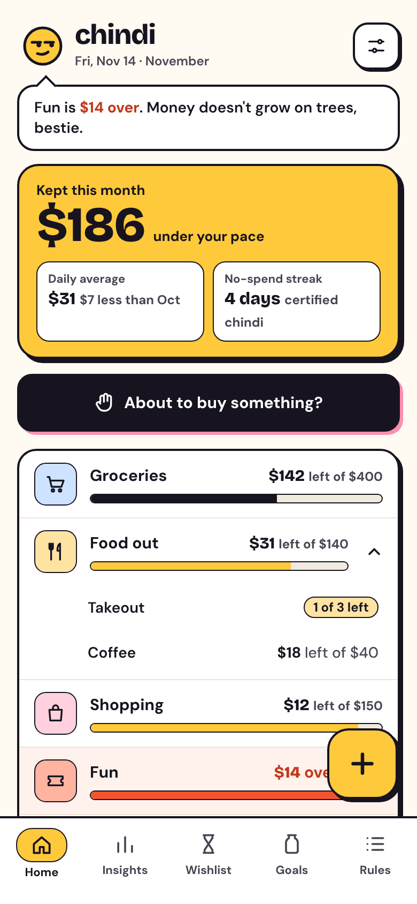

# chindi

Keep more. Regret less. A manual-entry budgeting PWA with a little side-eye.



React + TypeScript + Vite, FastAPI + SQLAlchemy + Alembic. SQLite for local use;
PostgreSQL and Caddy for self-hosting. No bank connection, paid API, or runtime AI.

## Run on this Windows machine

From this project's directory:

```powershell
.\start.ps1
```

Open **http://localhost:5173/** and choose **Create account** to create the first
account. Setup is skippable. No demo transactions or passwords are seeded.
The first account can register; further sign-ups are disabled by default.
Set `ALLOW_SIGNUPS=true` in `backend/.env` to allow more people to create accounts.
The current local installation has this enabled at the owner's request.

The launcher builds and serves the current PWA, including its update worker, so an
installed app can receive new versions. Reopen the app while online to pick up an
update. Use `.\start.ps1 -Dev` only when developing with live source reloads.

Sign in once and the app resumes your session on later opens, using a rotating
60-day HTTP-only cookie. In Settings → Sign-in & security, add a passkey to sign in
with Face ID, a fingerprint or your device PIN when authentication is needed.
Passkeys require a domain name and a secure context: use `localhost` locally and
HTTPS on a phone. An IP-address URL cannot enroll passkeys. Passkeys belong to the
hostname where they were created; enroll again when moving to the hosted domain.
Saved sessions rely on the device's screen lock; this is not a separate biometric
lock each time the app opens.

Generate and privately save a recovery code from the same Settings section.
Forgot password accepts that code once, sets a new password, and signs out all old
sessions. Generating a replacement invalidates the old code. Recovery codes and
passkeys are excluded from budget exports. Optional email reset links are available
after configuring `SMTP_HOST`, `SMTP_FROM`, and the SMTP connection settings in
`.env.example`; no email is claimed as sent when mail is unconfigured.

Categories start empty. Create and name your own during setup, in Settings →
Categories & limits, or directly in Quick Add. Limits are optional. You can log an
expense as Uncategorized and organize it later in History; it still counts toward
spending and account balances. Home shows spending until you set monthly amount
limits, then shows the combined amount assigned, spent and left in your monthly
buckets, including fixed bills. Subcategory limits sit within their parent's
amount limit. Spending outside buckets with amount limits appears separately.
The same amounts renew on the 1st of each month in your timezone, with no carryover;
receipts and account balances stay intact. Edit them through **Edit monthly amounts**
on Home. Queued offline expenses update the same totals and stay in their original
calendar month when synced. The daily average is labeled with its month and uses
only that month's flexible spending divided by the calendar days elapsed. It
starts fresh on the 1st; the no-spend streak continues across months. Upgrading
retires the old untouched starter
budget: unused presets are archived, used categories keep their history, and invented
limits are cleared. Customized categories and limits are preserved. Home comparisons
and Wrapped appear only when there is actual history to report.

Categories are optional: expenses can stay Uncategorized. History offers **Add
category** and **Manage categories** links. Its filters appear once entries exist
and include only categories/accounts actually used in those entries. Archived
labels are marked and retained only where they are needed for real history.

History shows purchase ratings as visible Love / Good / Meh / Regret badges.
Tap a badge to change it, or **Not rated · Add rating** to rate an expense without
editing its amount. You can clear a rating from the same picker. Weekly review
verdicts appear separately; changing a purchase rating preserves the review.
Ratings also remain visible while an offline expense waits to sync.

Quick Add shows each account's type under its name in Paid with and Paid into,
including the selected account. Transfer destinations and archived account choices
also show types, so matching bank names remain distinguishable.
History cards and account filters show the account type too, including archived
accounts and queued offline entries. Transfers identify both account names/types.

Quick Add has a visible **Transaction date**, defaulted to today in your budget's
timezone. Pick the day a missed transaction happened, or edit its date in History.
Optional time is under **Note, time & more**. Expenses dated in this month update
this month's average (monthly flexible spending divided by days elapsed). An entry
dated last month affects last month instead; account balances still include it.
Offline entries keep their selected date when synced.

Wishlist items have a visible, one-tap Delete action, including while their timer
is running. Removing an undecided item leaves spending and savings totals unchanged.

Stop with `./stop.ps1`. Data stays in `backend/chindi.db`. Logs are in `.runtime/`.
If PowerShell blocks locally downloaded scripts, use
`powershell -ExecutionPolicy Bypass -File .\start.ps1` for this invocation.

Prerequisites for a fresh checkout: **Python 3.12+, uv, Node.js 24+**. The launcher
installs dependencies if absent and applies migrations before starting the API.
It binds to loopback; use HTTPS hosting for access from your phone.

## Manual development

In one terminal:

```sh
cd backend
uv sync --frozen
uv run alembic upgrade head
uv run uvicorn app.main:app --reload --host 127.0.0.1 --port 8000
```

In another:

```sh
cd frontend
npm ci
npm run dev
```

API documentation: http://127.0.0.1:8000/api/v1/docs.
`backend/.env` is optional for local development; its example documents defaults.
Use one API worker because the scheduled maintenance runs inside that process.

## What you can use

- Email/password authentication with Argon2, 15-minute access tokens held in memory,
  rotating 60-day refresh cookies, and first-user-only registration.
- Accounts, two-level categories, amount or count limits, expenses, income, transfers,
  card payments, history search/filtering, edits, deletes, and balance adjustments.
- Account cards show Chequing, Savings, Credit card, Cash or Other. Delete removes
  an unused account after confirmation; transactions, incoming transfers and linked
  goals prevent deletion. Archive hides an account while preserving its history;
  restore it from Archived accounts. Sync pending entries before removal.
- Home totals, budget pace, daily averages, no-spend streaks, and category progress.
- IndexedDB expense queue, per-user cached Home, optimistic offline totals, retry and
  correction of rejected entries, and server-side client-ID deduplication.
- Skippable onboarding, personality quiz and share cards, Sweet/Savage quips,
  purchase pause, timed wishlist, goals and sinking funds, and weekly review.
- Rules, sentence-based insights, payday transfers to linked savings jars, levels,
  monthly Wrapped/share cards, subscriptions, and optional cost per use.
- Notification subscription and scheduled push jobs when VAPID is configured.
- JSON/CSV backup and restore from Settings. Restore replaces the current budget;
  export first if you want to preserve it. Auth credentials are never exported.

All monetary API fields are decimal strings. Client arithmetic uses integer cents.
Transfers, income, adjustments, and fixed bills do not count as flexible spending.
Sinking-fund expenses do not reduce kept. Calendar boundaries use the user's timezone.
Credit cards use negative balances for debt and show the amount owed.

## Self-host with HTTPS

1. Copy `.env.example` to `.env`.
2. Set a strong `POSTGRES_PASSWORD` and use the same URL-encoded password in `DATABASE_URL`.
3. Set `JWT_SECRET` to a random value, for example:
   `python -c "import secrets; print(secrets.token_urlsafe(48))"`.
4. Point your domain at the server, set `APP_DOMAIN` to that hostname and `APP_URL`
   to its `https://` origin. Expose TCP 80/443 and optionally UDP 443.
5. Run `docker compose up -d --build`.

The web image builds the frontend and serves it through Caddy, which provisions HTTPS.
The API applies migrations at startup. PostgreSQL and the API are not published to
the host. Keep the database and Caddy volumes when updating.

Install on iPhone with Safari → Share → Add to Home Screen; on Android use Install
app in the browser menu. The manifest includes a long-press Add expense shortcut.
The service worker caches the shell and locally bundled fonts/icons. Offline quick
add requires one successful login/Home load on that device. Reconnect with the app
open to sync; background sync while the app is closed is not implemented.

To enable push, generate VAPID keys (`npx web-push generate-vapid-keys`) and fill in
`VAPID_PUBLIC_KEY`, `VAPID_PRIVATE_KEY`, and `VAPID_SUBJECT`. Explain/install first,
then enable notifications in Settings. iPhone push requires an installed PWA.
Real iOS push delivery must be checked on the owner's HTTPS deployment.

For a nightly database backup, schedule `sh scripts/backup.sh` on the Docker host.
It keeps 14 days of dumps in `backups/`. For example, a host cron entry can run at
02:00 each night. Restore a SQL dump into an empty database with `psql`; JSON/CSV
restore is also available inside the app. Verify backups before relying on them.

## Verification

```sh
cd backend
uv run pytest
uv run ruff check .
uv run ruff format --check .
uv run mypy app --ignore-missing-imports
cd ../frontend
npm test
npm run lint
npm run build
npx playwright install chromium
npm run test:e2e
```

Browser tests start isolated API/frontend servers on ports 8001/5174 and use
`backend/chindi-e2e.db`; they never use the ordinary development database. They test
the production build, including its service worker. That database may be retained
between runs. Test accounts have disposable example.com addresses.

Docker/PostgreSQL deployment and physical iOS/Android installation require a host
and devices; these are separate from local browser verification. No server has
been deployed by this implementation.

The dependency audit currently reports low/moderate advisories in development-only
lint/PWA build dependencies, with no high/critical advisories reported. Review
upstream updates before an internet-facing release; don't use `audit fix --force`
to apply incompatible major downgrades. The runtime is a static frontend served by Caddy.

## Design and specification

The source spec is [docs/SPEC.md](docs/SPEC.md). Six reference screens and editable
HTML live under `design/`. Tokens and bundled fonts are in `frontend/src/styles/`.
Dark mode is outside v1. No external font service is needed.

Remaining polish against the full spec: per-personality layout variations, broader
automated visual comparison, and closed-app background sync. Core local budgeting
is usable; treat the later habit features as a first implementation to try with real
data rather than a production acceptance sign-off.

MIT licensed. Font files retain their upstream Bricolage Grotesque and DM Sans licenses.
